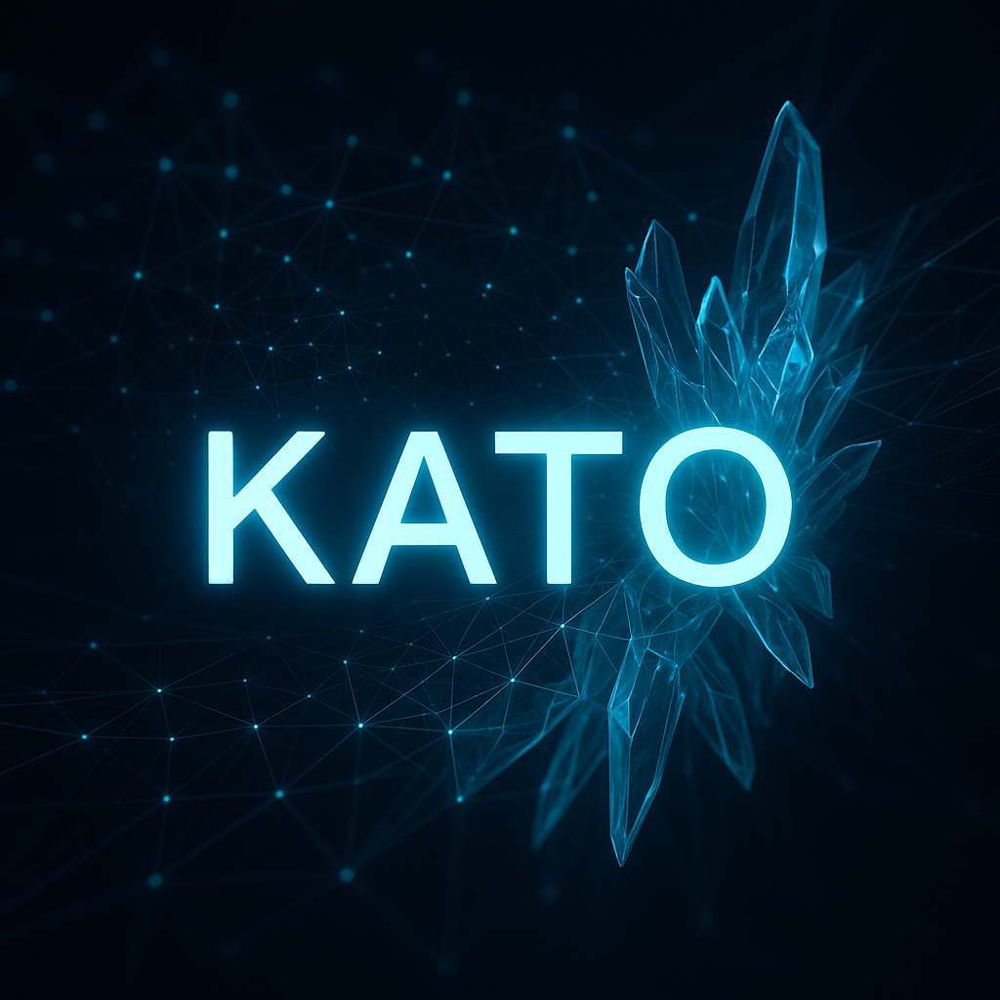
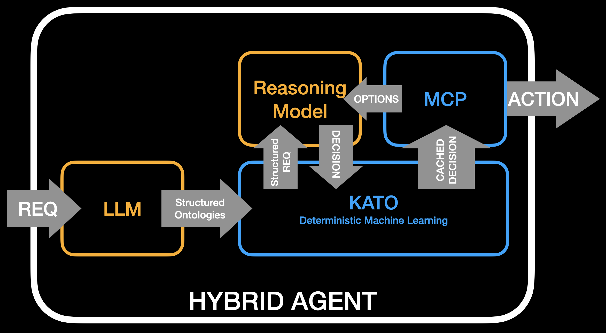

# KATO

**Knowledge Abstraction for Traceable Outcomes**

## Full deterministic control of AI

In 1899, aviation pioneers had lift and they had power. What Wilbur Wright found, twisting the ends of an empty inner-tube box in his Dayton bicycle shop, was the last missing piece: **control**, the ability to steer an aircraft moment to moment to where the pilot wants it to go.

Today's language models fly. They're powerful. But ask one why it trusted one output over another, or tell it to deliberately downweight a risky pattern, and there is nothing to twist. Its preferences live in the same weights as its knowledge, so you can't read them, trace them, or change one without disturbing the rest.

KATO is a deterministic machine learning system built so that every part of a decision is a control surface you can see, verify, and change:

1. **Emotives**: signed values you name in plain language (`utility`, `danger`, `satisfaction`), attached to learned patterns and carried by every prediction, so you can tell the system what matters.
2. **Prediction objects**: every prediction carries its past, present, and entire expected future, plus what matched, what was **missing**, and what showed up as **extras**, so you can see what it expected and exactly where reality diverged.
3. **Determinism**: no sampling, no temperature, no randomness in learning or prediction. The same knowledge base and the same input give the same ranked predictions.
4. **Editability**: when a prediction is wrong, retire the pattern that produced it and teach the right one. The very next prediction reflects the fix. No retraining, and no other pattern moves.
5. **The empty ensemble**: when nothing it has learned matches, KATO returns an empty list instead of a guess. That is how it says *"I don't know."*

KATO is the Apache-licensed successor to GAIuS, winner of Lockheed Martin's Sikorsky Entrepreneurial Challenge Award (2018), redesigned for enterprise use.



## What's Missing in Today's AI

> *A man can do what he wants, but he cannot want what he wants.*
>
> Arthur Schopenhauer, *On the Freedom of the Will* (1839)

Neither can a language model. Its preferences were fused into its weights during training, alongside everything it knows: unreadable, untraceable, uneditable.

Neuroscience shows what that costs. Patients with damage to the ventromedial prefrontal cortex keep their IQ, vocabulary, memory, and reasoning on paper, yet make catastrophically poor real-world decisions. What they lose is the value signal that tags an experience as good or bad as it happens, which Antonio Damasio called a *somatic marker* (*Descartes' Error*, 1994; Bechara & Damasio, *Games and Economic Behavior*, 2005). Knowledge without a value signal isn't intelligence. It's a library.

KATO keeps the two apart. Knowledge lives in learned patterns. Values live in emotives attached to those patterns. Both are records you can read, point at, and change.

## The Control Surfaces

### Emotives: values you name

When KATO observes and learns, you can attach **emotives**: signed numbers on whatever dimensions you care about, named by you.

```bash
curl -X POST http://localhost:8000/sessions/$SESSION/observe \
  -H "Content-Type: application/json" \
  -d '{"strings": ["payment_failed", "mobile_app"], "emotives": {"danger": 0.7, "utility": -0.4}}'
```

The values ride with the learned pattern. Each time the pattern recurs, its new values join a rolling window (`PERSISTENCE`, default 5) and are averaged, so the number moves as evidence accumulates. At prediction time, every object in the ensemble carries the emotives of the pattern that produced it. A danger score of 0.56 is not a feeling; it is an average over recorded observations, and you can go look at every one of them.

That gives an application a way to weigh candidate responses by what each is *worth*, not only by how well it fits. A support assistant can score its candidate replies by `satisfaction − cost − policy risk` and pick the second-best fit because it is the best outcome. A user-selected *mood* (which emotives count, how much each weighs, and where the hard veto lines are) can switch the same agent between cautious and customer-first at runtime, with the same knowledge and no retraining. KATO supplies the ensemble and its emotives; the mood is a scoring layer your application owns.

Who sets the values? Emotives answer how a system carries, applies, exposes, and corrects values, not which values it should hold. Choosing them stays a human governance decision. What KATO changes is that the decision is explicit instead of emergent. See [Emotives Processing](docs/research/emotives-processing.md) for the averaging algorithm and configuration.

### The prediction object: beyond the next token

A KATO prediction is not a single next token. It is an object with fields. Suppose KATO learned the pattern `[["alarm"], ["coffee", "wake_up"], ["commute", "shower"], ["arrive_office"], ["check_email"]]` and now observes `[["coffee", "wake_up"], ["commute", "radio"]]`:

```jsonc
{
  "name": "PTRN|…",                              // the learned pattern; trace is a pointer
  "frequency": 14,                               // times this pattern was learned
  "past":    [["alarm"]],                        // what led up to this moment
  "present": [["coffee", "wake_up"], ["commute", "shower"]],
  "future":  [["arrive_office"], ["check_email"]], // the whole expected continuation
  "matches": ["coffee", "commute", "wake_up"],
  "missing": [[], ["shower"]],                   // expected, but not observed
  "extras":  [[], ["radio"]],                    // observed, but never expected
  "similarity": …, "confidence": …, "evidence": …, "snr": …, "potential": …,
  "emotives": {"lateness_risk": 0.3}             // what mattered when it happened
}
```

`future` is the entire continuation, not one guess dressed up as an answer. `missing` and `extras` are the anomaly pair: in a next-token world an anomaly just looks like a low-probability guess, while here it is a labeled field telling you exactly where reality diverged from the pattern. Every number that ranked the prediction ships with it and can be redone on paper. See the [Prediction Object Reference](docs/reference/prediction-object.md) for all fields.

### Ensembles built at prediction time: learning in real time

What comes out of KATO at any moment is an **ensemble** of prediction objects, each a different plausible continuation with its own past, future, missing, extras, and emotives. That ensemble isn't looked up from something baked in at training time. It is built live, at the moment of prediction, from the patterns accumulated so far:

- **Learning is an insert.** A learned sequence is hashed (SHA-1) into its pattern name and stored; seeing it again increments its frequency. No gradient, no epoch, no loss curve.
- **Prediction is retrieval, then a cut.** Candidate patterns from this knowledge base are scored against short-term memory, anything below `recall_threshold` is discarded, and the survivors are ranked (by `potential`, unless you configure another metric).

A transformer learns its data once, freezes it into weights, and stays frozen until someone pays to retrain it. KATO models at prediction time instead of training time, so it never has to make that trade: a pattern learned this second shows up in the very next ensemble.

### The empty ensemble: "I don't know"

If no pattern clears `recall_threshold`, nothing survives the cut and the ensemble comes back as `[]`. Not a low-confidence guess, not a plausible-sounding paragraph, not a hedge. An empty list, telling you structurally that there is no matching pattern. KATO can only say what it has a pattern for, so when it has none, the honest answer falls out of the architecture.

The threshold is a dial you own: with a permissive `recall_threshold`, weak matches do come back, so set it to the evidence your use case demands.

### Editability: fix one prediction, touch nothing else

When a prediction is wrong, find the pattern that produced it (its name is in the prediction), retire it, and teach the right one:

```bash
# Hide the bad pattern from every prediction, immediately (reversible with /patterns/un-retire)
curl -X POST http://localhost:8000/sessions/$SESSION/patterns/retire \
  -H "Content-Type: application/json" \
  -d '{"pattern_ids": ["<pattern hash>"]}'

# Teach the correct sequence: observe it, then learn it
curl -X POST http://localhost:8000/sessions/$SESSION/observe \
  -H "Content-Type: application/json" \
  -d '{"strings": ["<correct>", "<symbols>"]}'
curl -X POST http://localhost:8000/sessions/$SESSION/learn
```

Two calls, a few seconds, no retraining, and no other pattern touched. Re-query and the corrected pattern answers, and you can prove both that the model was wrong and that it no longer is. A retired pattern can later be purged for good. See [Pattern Retirement](docs/users/pattern-retirement.md).

### ExCITE: what determinism makes possible

Every surface above works because of what sits underneath it: KATO is fully deterministic, and every prediction traces back to a pattern the system actually observed. A score on a prediction isn't a guess pulled from a black box; it's a fact you can verify. [ExCITE](https://medium.com/@sevakavakians/what-is-excite-ai-712afd372af4) names five capabilities a system needs before you let it decide anything about your money, your health, or your flight, each of which rests on that determinism:

| | Capability | Applied to one wrong prediction |
|---|------------|---------------------------------|
| **Ex** | Explain | Which stored pattern produced this answer, by name, not by approximation |
| **C** | Compute | The arithmetic that ranked it (similarity, confidence, potential), redoable on paper |
| **I** | Interpret | What the pattern actually says, in symbols a human reads, not a weight |
| **T** | Trace | The training record that put it there, and how many times it was seen |
| **E** | Edit | Retire the bad pattern, teach the right one, re-query to prove it, with no retraining |

Use ExCITE as a guide to the capabilities a use case needs. These capabilities were not bolted on as features; they follow from designing the system around determinism from the ground up.

## Why KATO?

*Because in AI, memory without traceability or understanding is just confusion.*

KATO is intended to be the *Linux of AI*: not just open source code and configuration, but an analytical **cognitive computing** model that doesn't require huge, power-hungry data centers. As an analytical model, KATO doesn't need tremendous amounts of data to generate quality outcomes, so KATO models and agents can run locally, preserving privacy. Its deterministic machine learning algorithm is editable in real time — each corrected pattern eliminates that error permanently.

KATO is built for highly regulated and mission-critical problem domains from which stochastic, GPT-based solutions are restricted. KATO's algorithms *and* its knowledge bases (i.e., trained data) are completely transparent and auditable — table stakes for AI regulation.

## What is KATO?

**KATO is predictive AI, not stochastic generative AI.**

Stochastic generative AI answers the question: *what would plausible content look like here?* It synthesizes — sampling from statistical distributions baked into billions of opaque weights. That's what makes it powerful for open-ended creation, and it's also *why* those models hallucinate: they are built to produce the plausible, not the observed. Predictive AI answers a different question: *given what has actually been observed, what happens next — and why?* KATO is built for that question. It observes, learns patterns, and predicts from evidence. Same knowledge base, same inputs, same outputs. No temperature. No sampling. No randomness.

Under the hood, KATO is a neuro-symbolic, **deterministic AI/ML architecture** that provides transparent, explainable machine learning through pattern-based learning — an alternative to neural networks for applications requiring real-time learning, complete traceability, and computational efficiency on commodity CPUs.

The "neuro" in KATO's neuro-symbolic design expresses its *connectionist* nature: KATO agents can consist of a network of cognitive processor nodes. These are not simple neural network nodes, but complete, deterministic, coherent processes that efficiently *emulate* cognitive functionality rather than expensively *simulate* brain structures, as artificial neural networks do.

So where does KATO fit in today's AI landscape? Three distinct ways:

1. **On its own, as predictive AI.** Sequence prediction, anomaly detection, decision support, and sensor fusion in domains where determinism, explainability, and auditability are mandatory. This is KATO's primary role.
2. **Alongside generative AI, in hybrid systems.** An LLM provides the natural-language interface; KATO provides deterministic memory, pattern prediction, and auditable decisions. See [Hybrid AI Systems](#hybrid-ai-systems-kato--llm) below.
3. **As a research frontier.** Active work ([KATO-LM](https://github.com/sevakavakians/kato-lm)) explores replacing the neural networks inside language models with KATO's deterministic machine learning. See [Research Frontier](#research-frontier-kato-lm) below.

### Pattern-Based Learning

KATO uses **patterns** as its core learning concept:

- **Temporal Patterns**: Time-ordered sequences with temporal dependencies
- **Profile Patterns**: Collections without temporal ordering requirements

Both are represented by the same pattern object: a sequence of events of symbols. Within each event, symbols are alphanumerically sorted for stronger pattern matching. Between events, order is preserved as learned. When sequence matters, store symbols across events; when it doesn't, store them within the same event. One representation serves all use cases.

Every learned structure is identified by a unique hash: `PTRN|<sha1_hash>` (stored in databases as the plain SHA1 hash without the prefix).

## Predictive AI vs Stochastic Generative AI

Understanding when to use KATO versus a stochastic generative model is critical for building effective AI systems:

| Feature | Stochastic generative AI (GPT, Claude, LLaMA) | KATO (Predictive AI) | Hybrid (KATO + LLM) |
|---------|------------------------------------|----------------------|---------------------|
| **Learning** | Batch pre-training on billions of tokens | Incremental learning from single observations | LLM for language, KATO for memory |
| **Hardware** | GPUs required ($1000s/month) | CPU-only ($50/month) | Reduced LLM calls = cost savings |
| **Explainability** | Black-box attention weights | Complete pattern traceability | Transparent decisions + language interface |
| **Determinism** | Non-deterministic (sampling) | Deterministic by design ([limits](docs/research/deterministic-ml-comparison.md#known-limits-on-end-to-end-determinism)) | Deterministic core + reasoning fallback |
| **Knowledge Updates** | Requires retraining | Direct database edits | Update patterns without retraining LLM |
| **Real-time Learning** | Not possible | Instant pattern learning | Adapt in production without downtime |
| **Regulatory Compliance** | Challenging (no audit trail) | Built-in (complete traceability) | Best of both worlds |
| **Startup Time** | 30–60 seconds (model loading) | 2–3 seconds | Fast initialization |
| **Memory** | 80GB+ GPU memory | 200–500MB RAM | Optimized resource usage |
| **Hallucinations** | Common (generates false info) | None (predicts only from observed patterns) | LLM for reasoning, KATO for facts |
| **Output** | Creative, fluent, novel content | Evidence-bound predictions | Creativity + accuracy |

**vs Traditional ML:**

- **Real-time learning**: Instant pattern updates vs batch retraining
- **Transparency**: Traceable patterns vs feature weights
- **Multi-modal**: Unified event model vs separate pipelines
- **Scalability**: Stateless horizontal scaling vs stateful challenges

## Deterministic Machine Learning, Compared

"Deterministic" means three different things in machine learning, and KATO is built to meet all three:

| Kind | Question | KATO |
|------|----------|------|
| **Algorithmic** | Does the method use randomness? | No. Learning is hashing and counting; prediction is exact alignment plus closed-form metrics. |
| **Order** | Does training-data order change the model? | Mostly no. Patterns are content-addressed and their statistics are commutative counts, so learning the same patterns in any order gives the same knowledge base. |
| **Implementation** | Same bytes across runs and workers? | Yes, on the same build and hardware, by engineering: total-order ranking, fixed float-summation order, recall-safe pruning. |

Order-independence makes **exact unlearning** possible: purging a pattern subtracts exactly what learning it added.

**Determinism alone does not set KATO apart.** Neural networks, LLMs and randomized ensembles meet few of these properties without heavy configuration. Classical interpretable models can meet all three: logistic regression with a deterministic solver, single decision trees, Naive Bayes, scorecards and rules engines. What distinguishes KATO is what it pairs with determinism: one-shot incremental learning, exact unlearning by subtraction, and native sequence matching.

| Family | No randomness | Order-independent | Byte-reproducible | Exact unlearning | Learns incrementally | Sequence-native |
|--------|:-------------:|:-----------------:|:-----------------:|:----------------:|:--------------------:|:---------------:|
| **KATO** | ✅ | ✅ mostly | ✅ | ✅ | ✅ | ✅ |
| Deep nets (SGD) | ❌ | ❌ | ⚙️ | ❌ | ⚠️ | ✅ RNN / transformer |
| LLM inference | ❌ | n/a | ❌ | ❌ | ❌ | ✅ |
| Random forests | ⚙️ | ❌ | ⚙️ | ❌ | ❌ | ❌ |
| Logistic regression | ✅ | ✅ | ⚙️ | ❌ | ❌ | ❌ |
| Single decision tree | ✅ | ✅ | ✅ | ❌ | ❌ | ❌ |
| Scorecards / rules engines | ✅ | n/a / ⚠️ | ✅ | n/a | ❌ | ❌ |
| Naive Bayes | ✅ | ✅ | ✅ | ✅ | ✅ | ❌ |
| Exact k-NN, alignment distance | ✅ | ✅ | ⚙️ | ✅ | ✅ | ✅ |
| n-gram / variable-order Markov | ✅ | ✅ | ✅ | ✅ | ✅ | ⚠️ next symbol |
| HMM, supervised | ✅ | ✅ | ✅ | ✅ | ✅ | ✅ |

**Legend:**
- ✅ holds by default
- ⚙️ holds once configured (pinned seed, solver or thread count)
- ⚠️ holds only partially or in some variants
- ❌ does not hold
- n/a does not apply

**Closest relatives**: Alignment-based k-NN, variable-order Markov models and supervised HMMs share most of these properties. KATO is not a new class of learner. It brings these properties together with:
- event structure;
- partial matching anywhere in short-term memory, returning the whole stored future;
- per-prediction past / present / future / missing / extras;
- ensemble information-theoretic metrics;
- a serving layer engineered to stay reproducible at scale.

**The trade-off**: KATO generalizes less than neural networks or linear models. It predicts from what it has observed and does not interpolate beyond it, which is also why it cannot hallucinate.

The [Deterministic ML Comparison](docs/research/deterministic-ml-comparison.md) gives the full analysis: 20 ML families with solver and configuration caveats, the trade-offs, and the [known limits on end-to-end determinism](docs/research/deterministic-ml-comparison.md#known-limits-on-end-to-end-determinism).

## When to Use KATO

### Choose KATO When:

- ✅ **Explainability is mandatory** (regulatory, safety-critical, compliance)
- ✅ **Deterministic behavior required** (testing, certification, reproducibility)
- ✅ **Real-time learning needed** (adapt from observations without retraining)
- ✅ **Cost efficiency matters** (no GPU budget, edge deployment)
- ✅ **Knowledge correction valuable** (fix errors post-deployment via database edits)
- ✅ **Temporal patterns primary** (sequences, workflows, time-series)
- ✅ **Multi-tenancy required** (isolated knowledge bases per user/organization)

### Choose Stochastic Generative AI When:

- ✅ **Open-ended generation primary** (creative writing, code generation, brainstorming)
- ✅ **Zero-shot learning needed** (handle completely novel domains)
- ✅ **Deep semantic understanding** (natural language nuance, context, ambiguity)
- ✅ **Fluency critical** (human-like text generation)

### Combine Them When You Need Both

See the next section.

## Hybrid AI Systems (KATO + LLM)



Generative models excel at language understanding; KATO excels at deterministic memory and prediction. Together they address each other's fundamental limitations: the LLM provides the natural-language interface and open-ended reasoning, while KATO provides a **deterministic pattern-based learning layer** that learns context + action + outcome patterns.

```
Natural Language Input
         ↓
   LLM (Language Understanding) ← Semantic comprehension, reasoning
         ↓
   KATO (Pattern Memory) ← Deterministic recall, evidence-bound prediction
         ↓
   Decision Engine ← Transparent, traceable actions
         ↓
   Action Execution
```

**What KATO contributes to the hybrid:**

1. **Caching for reduced LLM calls**: Store proven patterns for instant recall — orders of magnitude faster and cheaper (10–100x cost reduction)
2. **Traceable storage**: All patterns stored in ClickHouse with complete audit trails
3. **Real-time learning**: Adapt to new patterns instantly, without retraining
4. **Guardrails**: Pattern-based constraints keep decisions within observed, approved bounds
5. **Remediation**: If an action needs correction, edit the pattern in the database — changes take effect immediately, no retraining cycles

**Example workflow**:

```bash
# Pattern learned from experience
Context: ["user_frustrated", "payment_failed", "mobile_app"]
Action: ["escalate_to_human", "offer_refund"]
Outcome: ["issue_resolved", "satisfaction_score_9"]

# If the action proves incorrect, fix it with SQL:
UPDATE patterns_data
SET pattern_data = [['new', 'correct', 'action']]
WHERE kb_id = 'production' AND name = 'pattern_hash';

# Next time the same context appears → corrected action (no retraining)
```

**Production examples**:

- **Customer support bot**: LLM understands user intent → KATO recalls relevant cases/solutions → LLM phrases the response
- **Medical diagnosis assistant**: LLM processes symptoms → KATO matches symptom patterns → LLM explains the diagnosis, with full traceability
- **Financial advisory**: LLM understands client goals → KATO predicts portfolio patterns → LLM communicates recommendations

## Research Frontier: KATO-LM

KATO's primary role is predictive AI — but its deterministic machine learning is also being investigated as a **replacement for the neural networks at the core of language models**. That research lives in the [KATO-LM project](https://github.com/sevakavakians/kato-lm).

Where a transformer flattens text into one enormous context window and learns token statistics in billions of opaque weights, KATO-LM builds a **hierarchy**. Node 0 learns raw tokens in fixed chunks of 15 (no sentence detection, no parsing), and every learned pattern gets a name. That name then becomes a token one level up: node 1 learns sequences of node 0 names (roughly a paragraph, ~225 tokens of original text), node 2 learns sequences of node 1 names (a section, ~3,375 tokens), and node 3 learns sequences of node 2 names (a chapter or document, ~50,625 tokens). Compression is 15 : 1 per level, and it is lossless: a node 3 pattern unravels downward, name by name, to every original token. It is how vision works, from pixels to edges to shapes to objects: the semantics are in the composition, not in the tokens.

KATO-LM generates text by selecting high-level patterns and unraveling them hierarchically, so every generated word has an address. The constraint is the point: it can only produce sequences that were actually observed (or are compositions of observed sequences) in the training corpus. A model that cannot say what it never saw cannot hallucinate.

**What deterministic ML brings to language modeling**:

- **Zero hallucinations** — cannot generate facts absent from the training corpus
- **Complete transparency** — every generated token traceable to a source pattern with a frequency count
- **Determinism** — same seed + context → same output, fully reproducible
- **Multi-scale control** — generate at sentence, paragraph, chapter, or document level

**Trade-offs**: less creative than transformers (recombines learned patterns only); requires a training corpus that covers the target domain; cannot synthesize novel facts or reasoning beyond training data.

**Status**: Experimental. Pattern learning infrastructure complete; basic generation implemented; advanced multi-scale sampling in active development. This is research into the future of KATO's machine learning — not KATO's recommended production use today. But if it succeeds, the machine learning inside a language model stops being a black box.

## KATO for Regulated & Safety-Critical Systems

In domains where errors have serious consequences — healthcare, aerospace, defense, finance, manufacturing — AI systems must meet requirements that stochastic generative models cannot satisfy. KATO was designed for these environments.

**Regulatory compliance built in**:

- ✅ **Complete audit trails** — every prediction traceable to source patterns (GDPR Article 22, HIPAA, SOX, Basel III)
- ✅ **Explainable decisions** — stakeholders understand "why" without technical expertise
- ✅ **Real-time correction** — fix errors immediately via database updates, no retraining downtime, no recertification delays
- ✅ **Deterministic behavior** — no randomness in learning or matching; the same knowledge base and inputs produce the same ranked predictions (required for certification: DO-178C, IEC 62304, ISO 26262)
- ✅ **Validation & verification** — pattern-based logic can be formally tested and certified

**Sensor fusion for mission-critical applications**. Building on GAIuS's award-winning sensor-fusion capabilities, KATO integrates multiple sensor streams in real time — vision embeddings, IoT telemetry, audio, time-series, and geospatial data — in a single unified event model:

```python
# Aerospace: multi-sensor anomaly detection
observe([
    ["altitude|3500", "speed|250", "temp|normal"],  # Flight data
    ["VCTR|image_embed_123"],                       # Vision system
    ["vibration|0.2", "fuel|80pct"]                 # Sensor readings
])
predictions = get_predictions()  # Detects patterns indicating maintenance needs
```

**Industry applications**:

- **Healthcare & medical devices**: patient deterioration prediction, device anomaly detection, clinical decision support with audit trails
- **Aerospace & defense**: aircraft health monitoring, multi-sensor situational awareness, flight data analysis with full traceability
- **Financial services**: fraud detection with explainable scoring, compliance-ready pattern recognition, risk assessment with audit trails
- **Manufacturing & industrial IoT**: predictive maintenance, quality control with traceable decisions, process anomaly detection
- **Autonomous vehicles & robotics**: sensor fusion for perception, deterministic decision-making for safety certification, real-time learning from edge cases

**Knowledge management**: KATO's atomic, hash-addressed, cross-referenced patterns also make it a natural engine for personal and team knowledge bases — a digital [Zettelkasten](docs/integration/zettelkasten.md) or "second brain" with algorithmic pattern completion.

## Key Features

- ✨ **Deterministic Learning** - No randomness in learning or prediction; reproducible ranked predictions
- 🔍 **Full Transparency** - All internal states and decisions are explainable
- 🎯 **Temporal Predictions** - Sophisticated past/present/future segmentation
- 🧠 **Multi-Modal Sensor Fusion** - Integrate text, vectors, vision systems, and multiple sensor streams
- 🎚️ **Emotives** - Named, signed value signals on patterns, carried by every prediction
- 🧾 **Prediction Objects** - Past, present, future, matches, missing, and extras in every prediction
- 🛑 **Empty Ensemble** - Returns `[]` instead of a guess when nothing learned matches
- ✏️ **Real-Time Editing** - Retire, un-retire, and purge individual patterns with no retraining
- 📋 **ExCITE Capabilities** - Explain, Compute, Interpret, Trace, Edit, all resting on determinism
- ⚡ **High Performance** - 3.57x throughput, 72% latency reduction, comprehensive optimizations
- 🔄 **Session Context** - Maintains observation context within isolated sessions
- 🎪 **Vector Database** - Modern vector search with Qdrant (10-100x faster)
- 👥 **Multi-User Sessions** - Complete STM isolation per user session
- 💾 **Write Guarantees** - ClickHouse and Redis ensure data durability
- 🔐 **Session Management** - Redis-backed sessions with TTL and isolation

## Performance

### CPU-Powered Intelligence at GPU-Scale Speed

KATO achieves competitive performance on commodity CPUs through algorithmic optimization — no GPUs required. Ideal for cost-sensitive deployments, edge computing, and organizations without GPU infrastructure.

**Current metrics** (single instance, pre-warmed cache):

- **Latency**: 1–5ms per observation; 123ms average under benchmark load (72% reduction)
- **Throughput**: 200+ observations/second per instance (3.57x improvement)
- **Memory**: 200–500MB per processor
- **Startup**: 2–3 seconds
- **Vector search**: 10–100x faster with Qdrant

**Benchmarks** (optimized vs baseline):

| Batch Size | Throughput (obs/sec) | Latency (ms) | Improvement |
|------------|---------------------|---------------|-------------|
| 10 obs     | 203.71 vs 57.00     | 122.73 vs 438.62 | **3.57x** |
| 50 obs     | 406.50 vs 114.29    | 49.09 vs 175.32  | **3.56x** |
| 100 obs    | 658.68 vs 185.19    | 30.35 vs 108.11  | **3.56x** |

**How**: Bloom filter pre-screening (O(1) candidate filtering), Redis pattern caching (80–90% hit rate), ClickHouse multi-stage filter pipeline (MinHash/LSH/Bloom) for billion-scale performance, connection pool optimization, and async parallel processing.

**Monitoring endpoints**: `/performance-metrics`, `/connection-pools`, `/cache/stats`, `/distributed-stm/stats`

**Scaling**: vertical (more resources per container), horizontal (multiple instances behind a load balancer). See the [Performance Guide](docs/developers/performance-profiling.md) and `docs/archive/optimizations/` for detailed benchmarks.

## Quick Start

### Prerequisites

- Docker and Docker Compose
- Python 3.9+ (for local development)
- 4GB+ RAM recommended
- ClickHouse, Qdrant, and Redis (all auto-started with Docker)

### Option 1: Pre-Built Container Images (Recommended)

```bash
# Always use latest stable (for development)
docker pull ghcr.io/sevakavakians/kato:latest

# Recommended for production - pin to an exact release.
# Release numbers: https://github.com/sevakavakians/kato/releases
docker pull ghcr.io/sevakavakians/kato:<version>
```

| Tag | Description | Use Case |
|-----|-------------|----------|
| `X.Y.Z` | Specific version (immutable) | Production - pin to an exact release |
| `X.Y` | Latest patch for that minor | Auto-receive security/bug fixes |
| `X` | Latest minor for that major | Track a major version line |
| `latest` | Latest stable release | Development and testing |

To use a pre-built image with Docker Compose, replace the `build` section with `image: ghcr.io/sevakavakians/kato:<version>`. See the [Deployment Guide](docs/operations/docker-deployment.md) for complete instructions.

### Option 2: Build from Source

```bash
git clone https://github.com/sevakavakians/kato.git
cd kato
./start.sh start

# Services will be available at:
# - KATO Service: http://localhost:8000
# - ClickHouse: http://localhost:8123
# - Qdrant: http://localhost:6333
# - Redis: redis://localhost:6379
```

### Verify Installation

```bash
curl http://localhost:8000/health
# {"status": "healthy", "service_name": "kato", "uptime_seconds": 123.45, ...}

# Interactive API docs: http://localhost:8000/docs
```

### Basic Usage

```bash
# 1. Create a session (node_id identifies your knowledge base)
SESSION=$(curl -s -X POST http://localhost:8000/sessions \
  -H "Content-Type: application/json" \
  -d '{"node_id": "alice"}' | jq -r '.session_id')

# 2. Observe
curl -X POST http://localhost:8000/sessions/$SESSION/observe \
  -H "Content-Type: application/json" \
  -d '{"strings": ["hello", "world"]}'

# 3. Learn a pattern
curl -X POST http://localhost:8000/sessions/$SESSION/learn

# 4. Get predictions
curl http://localhost:8000/sessions/$SESSION/predictions
```

**💾 Data persistence**: your `node_id` is your persistent identifier — reconnect with the same `node_id` to reach all trained patterns. Sessions (STM, emotives) are temporary and expire; learned patterns persist forever. See the [Database Persistence Guide](docs/users/database-persistence.md).

### Key Endpoints

| Endpoint | Method | Description |
|----------|--------|-------------|
| `/sessions` | POST | Create new session |
| `/sessions/{id}/observe` | POST | Add observation |
| `/sessions/{id}/learn` | POST | Learn pattern |
| `/sessions/{id}/predictions` | GET | Get predictions |
| `/sessions/{id}/stm` | GET | View STM |
| `/sessions/{id}/config` | POST | Update config |
| `/health` | GET | Health check |
| `/metrics` | GET | Performance metrics |

> **⚠️ All operations require session-based endpoints.** Full details: [API Reference](docs/users/api-reference.md) | Interactive docs: http://localhost:8000/docs

## Core Concepts

KATO processes observations as **events** containing strings, vectors, and emotives. Each event is processed through:

- **Alphanumeric sorting** within events
- **Deterministic hashing** for patterns (`PTRN|<sha1_hash>`)
- **Temporal segmentation** in predictions (past / present / future)
- **Empty event filtering**
- **Minimum requirement**: 1+ strings in STM for predictions (single-symbol fast path available; vectors contribute strings)

Learn more in [Core Concepts](docs/developers/concepts.md) or the [User Guide](docs/users/concepts.md).

## Architecture Overview

KATO uses a FastAPI service with embedded processors:

```
Client Request → FastAPI Service (Port 8000) → Embedded KATO Processor
                           ↓                                    ↓
                    Async Processing              ClickHouse, Qdrant & Redis
                           ↓                       (Isolated by session_id)
                    JSON Response
```

**Session isolation**: Redis isolates session state by `session_id`; ClickHouse isolates patterns by `kb_id` partitioning; Qdrant isolates vectors per collection. Multiple sessions can share one `node_id` knowledge base while keeping STM, emotives, and configuration isolated.

See [Architecture](docs/developers/architecture.md) for full design details.

## Configuration

KATO is configured through environment variables with Pydantic-based validation. The most commonly tuned parameters:

```bash
MAX_PATTERN_LENGTH=0        # Auto-learn after N observations (0=manual)
RECALL_THRESHOLD=0.1        # Pattern matching threshold (>0.0-1.0)
STM_MODE="CLEAR"            # STM mode after auto-learn (CLEAR/ROLLING)
MAX_PREDICTIONS=100         # Maximum predictions to return
SESSION_TTL=3600            # Session time-to-live (seconds)
```

Sessions can also carry independent per-session configuration set at creation or via `/sessions/{id}/config`. For all parameters, see the [Configuration Guide](docs/operations/configuration.md).

## Service Management & Testing

```bash
./start.sh start            # Start all services (bare ./start.sh prints help)
docker compose down         # Stop all services
docker compose ps           # Check status
docker compose logs kato    # View logs

# Run the test suite (services must be running)
./run_tests.sh --no-start --no-stop
```

Tests run in local Python against the running services — no Docker-in-Docker, automatic per-test isolation, parallel-safe. **Current status**: 445+ tests across unit, integration, API, and performance suites. See the [Testing Guide](docs/developers/testing.md).

## Troubleshooting

Common quick fixes:

- **Services won't start**: check ports 8000/8123/6333/6379 with `lsof`, then `docker compose down && docker compose up -d`
- **Tests failing**: confirm services are healthy (`curl http://localhost:8000/health`), then `docker compose restart`
- **Memory issues**: `docker system prune -f`, then restart with fresh state
- **`clickhouse-init` container exits after startup**: this is expected — it initializes the schema, exits with status 0, and stays in "Exited" state

See [Known Issues](docs/maintenance/known-issues.md) and the [Troubleshooting Guide](docs/users/troubleshooting.md) for more.

## Documentation

**Start here**: [docs/00-START-HERE.md](docs/00-START-HERE.md) — central navigation hub, organized by role (user, developer, operator, researcher, integrator).

### 📚 Getting Started
- [Jupyter Notebook Tutorials](https://github.com/sevakavakians/kato-tutorials) - Dataset examples and repeatable usage patterns
- [Quick Start Guide](docs/users/quick-start.md) - Get running in 5 minutes
- [User Guide](docs/users/concepts.md) - Understand the architecture and usage
- [API Reference](docs/users/api-reference.md) - Complete endpoint documentation
- [Glossary](docs/reference/glossary.md) - Terms and concepts defined

### 🚀 Deployment & Operations
- [Docker Guide](docs/operations/docker-deployment.md) - Container deployment
- [Configuration Guide](docs/operations/configuration.md) - All parameters explained
- [Multi-Instance Guide](docs/integration/multi-instance.md) - Run multiple KATO processors
- [Network Topology Patterns](docs/operations/network-topology.md) - Connect instances in various topologies
- [Production Scale Migration Plan](docs/operations/production-scale-migration.md) - Scaling strategy for production workloads

### 🔧 Development & Research
- [Developer Concepts](docs/developers/concepts.md) - KATO's internal behavior
- [Architecture](docs/developers/architecture.md) - System design
- [Testing Guide](docs/developers/testing.md) - Write and run tests
- [Contributing](docs/developers/contributing.md) - Development guidelines
- [Prediction Object Reference](docs/reference/prediction-object.md) - Complete field documentation
- [Research Docs](docs/research/) - Pattern theory, information theory, algorithms

## Contributing

We welcome contributions! Please see our [Contributing Guide](docs/developers/contributing.md) for development setup, code guidelines, testing requirements, and the pull request process.

## License

Licensed under the Apache License, Version 2.0 — see [LICENSE](LICENSE) and [NOTICE](NOTICE).

## Heritage

KATO is derived from the [GAIuS](https://medium.com/@sevakavakians/what-is-gaius-a-responsible-alternative-to-neural-network-artificial-intelligence-part-1-of-3-1f7bbe583a32) framework, which won **Lockheed Martin's Sikorsky 8th Entrepreneurial Challenge Award in 2018** for its breakthrough approach to integrating multiple sensor streams — vision systems, telemetry, audio, and environmental data — into a unified, explainable prediction framework. GAIuS was also reviewed against the FAA's DO-178C standard for airborne software and passed Stage of Involvement 1 (SOI #1). KATO retains GAIuS's transparent, symbolic, and physics-informed learning process and its [ExCITE](#excite-what-determinism-makes-possible) capabilities, redesigned for enterprise use and released under the Apache License.

## Release history

See [CHANGELOG.md](CHANGELOG.md) for every release, and the
[releases page](https://github.com/sevakavakians/kato/releases) for the current
version and its container images.

This README describes how KATO behaves now; it deliberately does not name release
versions, so that nothing here can quietly go stale. Where a feature needs one,
the page documenting that feature says which release introduced it.

## Support

- 📖 [Documentation](docs/) - Complete documentation
- 🐛 [Issue Tracker](https://github.com/sevakavakians/kato/issues) - Report bugs
- 💬 [Discussions](https://github.com/sevakavakians/kato/discussions) - Ask questions

KATO only works if you can open it, so open it. If you dislike any part of it, fix it: contributions are welcome. If transparent, deterministic, controllable AI matters to your domain, let's build it together.

---

*Because in AI, memory without traceability or understanding is just confusion.*
