# Ranking Benchmark: Which `rank_sort_algo` to Use

How often each ranking key puts a prediction with the right next event on top: 5,112 held-out queries on 14 nodes, 20 ranking keys, recall thresholds 0.1, 0.3, 0.5. Measured through the REST API of a running KATO instance; [How It Was Measured](#how-it-was-measured) has the details.

**Note.** Intel Core i9-8950HK, 6 cores (12 threads), 32 GB, macOS 15.8.2; KATO under Docker Desktop (12 CPUs, 23.5 GB), 4 workers

> This page is generated by `python -m benchmarks.ranking.report` from the result files of one run. Do not edit it by hand. The instance, the machine and the date of the run are in [`run.json`](../../benchmarks/results/ranking/guide/run.json). To measure your own instance, see [Reproducing](#reproducing).

For what each metric is and how it is computed, see the [Prediction Object Reference](prediction-object.md).

## At a Glance

`potential` is the best key, or level with the best, in 21 of the 22 cases. Next: `predictive_information` (19), `good_odds` (17), `bayesian_posterior` (17). On the 4 kinds of data `potential` never saw when its weights were fitted, it is ahead of the best other key on 1, level on 2 and behind on 1. On the mean of the kinds, `potential` puts a right prediction on top in 0.545 of the queries; the top entry of `future_potentials`, which is the same whatever the key, is right in 0.580.

## Reading the Results

What this run says about the choices a KATO user has to make, in the order they come up. A figure is in a table further down unless the text says where else it comes from. A point is one query in a hundred.

**For the next event, read `future_potentials`.** Its top entry is right in 0.580 of the queries on the mean of the eight kinds of data. That is 3.5 points more often than the first prediction with a future under `potential`, the best ranking key, and it is the same whatever `rank_sort_algo` is. A ranking picks one pattern. The entry adds up every candidate that proposes the same event, and that is the stronger evidence where many patterns match equally well. The answer stays traceable: the patterns behind an entry are the predictions whose `future` begins with its event. `supporting_patterns` counts them, and `max_predictions` has to be large enough to return them all.

**For a ranked list, keep the default, `potential`.** It is the best key or level with the best in 21 of the 22 cases, and a right answer is among its first five predictions in 0.713 of the queries, against 0.649 for `predictive_information`. Go down the list to the first prediction whose `future` is not empty, because `potential` can rank a pattern that has ended first: on click streams its first prediction is right in 0.215 of the queries and its first prediction with a future in 0.650.

**If your code takes `predictions[0]` as it stands, rank by `predictive_information`.** Its first prediction names an event in 99.9% of the queries and is right in 0.535. That of `potential` names an event in 89.3% and is right in 0.478.

**Where the default loses.** On the loan-application log `potential` answers 0.660 of the queries right and `predictive_information` 0.785. In all 28 queries that only `predictive_information` gets right, both keys choose a pattern that contains the whole STM. `potential` takes the shorter of the two, in 26 of them also the more frequent one, and its pattern has 2.4 events left on average where the other has 5.0. The top entry of `future_potentials` names the right event in 21 of the 28. What is said here about the candidates comes from asking those 28 queries again, since the result files keep counts and no candidates. One data set shows this. The mechanism says to expect it wherever many learned sequences share a stretch and then go different ways, as the cases of a process do. There, read `future_potentials`.

**Leave `recall_threshold` at 0.1 unless you need the time.** From 0.1 to 0.5 the share right falls from 0.545 to 0.344 under `potential`, and the answers that remain are no more reliable: on no kind of data does the share right among the answered queries rise. `similarity` divides by the length of the pattern, so a higher threshold removes the long patterns first, and for a short STM those are the ones it came from. The configuration guide shows [how much of a pattern must be observed](../users/configuration.md#recall_threshold) at each threshold. What the threshold buys is time. On generated data the candidates per request fall from 935 to 14, and on the machine of this run a request takes about 41 ms plus 0.42 ms per candidate.

**The ranking key does not change the request time,** as far as this run can tell. Keys that return the very same response differ in their median times as much as any two keys do.

**Do not rank by a key that ties.** `confidence`, `event_cohesion`, `onset_alignment`, `snr` and `fragmentation` share their top value among several predictions in more than 80% of the queries, and the pattern name then decides which comes first. `good_odds` and `bayesian_posterior` rank alike, as do `frequency` and `bayesian_prior`, so the choice within a pair changes nothing.

**To know whether a sequence is over, read `ends_here`.** On six of the eight kinds it tells ended sequences from continuing ones with an area under the ROC curve of 0.957 to 0.996. On click streams it does not (0.597), and the music node has only 12 endings.

**Trust the stated probability on a well-filled node, not on a sparse one.** Over all queries the top entry of `future_potentials` states 0.731 on average and is right in 0.730. On the music node it states 0.658 and is right in 0.255; on text, 0.313 and 0.101. `chance_posterior` marks both: it is above 0.5 in 39.5% of the music queries and 63.3% of the text queries, and in 0% to 9.5% of the queries elsewhere.

**How far this goes.** A case has 200 queries, so a share carries about 7 points either way. Eight kinds of data are not every kind. The times are from one laptop.

## Which Key for Which Case

The table follows one rule, fixed before the run. In each case the best key is the one with the highest share of queries answered right. A key is **level** with it when the 95% interval of the difference between the two, measured on the same queries, includes zero. Read-out: the top-ranked prediction that has a `future`. `recall_threshold` 0.1.

**Groups of cases**

| Case | Queries | Best key | Share right | Level with the best |
| --- | ---: | --- | ---: | --- |
| Generated data, every situation | 3,000 | `potential` | 0.818 | none |
| The public data sets | 1,400 | `potential` | 0.506 | `predictive_information` |
| Kinds of data `potential` was fitted on | 600 | `potential` | 0.530 | `predictive_information` |
| Kinds of data `potential` never saw | 800 | `potential` | 0.489 | `bayesian_likelihood`, `predictive_information`, `itfdf_similarity` |

**Public data sets**

| Case | Queries | Best key | Share right | Level with the best |
| --- | ---: | --- | ---: | --- |
| System logs: HDFS block traces | 200 | `potential` | 0.880 | `predictive_information`, `good_odds`, `bayesian_posterior` |
| Click streams: msnbc.com page visits | 200 | `predictive_information` | 0.655 | `potential`, `good_odds`, `bayesian_posterior` |
| Text: WikiText-2 sentences | 200 | `potential` | 0.060 | `snr`, `event_cohesion`, `global_normalized_entropy`, `itfdf_similarity`, `confidence`, `good_odds`, `bayesian_posterior`, `bayesian_likelihood`, `entropy`, `normalized_entropy`, `evidence`, `frequency`, `bayesian_prior`, `onset_alignment` |
| Finance: Loan applications (BPI Challenge 2012) | 200 | `predictive_information` | 0.785 | `bayesian_likelihood`, `itfdf_similarity` |
| Healthcare: Hospital pathways of sepsis cases | 200 | `potential` | 0.550 | `predictive_information` |
| Music: Bach chorale chord progressions | 200 | `potential` | 0.225 | `confluence`, `onset_alignment`, `similarity`, `evidence`, `predictive_information`, `good_odds`, `bayesian_posterior`, `bayesian_likelihood`, `snr` |
| Computing: UNIX shell sessions | 200 | `good_odds`, `bayesian_posterior` | 0.530 | `bayesian_likelihood`, `potential` |

**Generated data, one condition at a time**

| Case | Queries | Best key | Share right | Level with the best |
| --- | ---: | --- | ---: | --- |
| STM of 5 events, mid-pattern | 200 | `good_odds`, `bayesian_posterior` | 0.820 | `potential`, `predictive_information` |
| STM of 2 events | 200 | `potential` | 0.675 | `good_odds`, `bayesian_posterior`, `predictive_information` |
| STM of 10 events | 200 | `good_odds`, `bayesian_posterior`, `bayesian_likelihood` | 0.895 | `predictive_information`, `potential` |
| First 5 events of a pattern | 200 | `potential` | 0.890 | `predictive_information`, `good_odds`, `bayesian_posterior` |
| First quarter of a pattern | 200 | `potential` | 0.920 | `predictive_information`, `good_odds`, `bayesian_posterior` |
| First three quarters of a pattern | 200 | `potential` | 0.910 | `predictive_information`, `snr` |
| No noise | 200 | `potential` | 0.875 | `good_odds`, `bayesian_posterior`, `predictive_information` |
| 20% noise | 200 | `potential` | 0.680 | `good_odds`, `bayesian_posterior` |
| STM across two patterns | 200 | `potential` | 0.675 | `predictive_information` |
| Patterns learned equally often | 200 | `potential` | 0.780 | `good_odds`, `bayesian_posterior`, `predictive_information`, `bayesian_likelihood` |
| Strongly skewed frequencies | 200 | `predictive_information` | 0.935 | `potential`, `good_odds`, `bayesian_posterior` |
| Events of 1 to 5 symbols | 200 | `good_odds`, `bayesian_posterior` | 0.895 | `potential`, `predictive_information`, `bayesian_likelihood` |
| Vocabulary of 50 symbols | 200 | `potential` | 0.810 | `good_odds`, `bayesian_posterior`, `predictive_information` |
| Stream, boundaries given | 200 | `potential` | 0.770 | `predictive_information` |
| Stream, boundaries not given | 200 | `good_odds`, `bayesian_posterior` | 0.765 | `potential`, `predictive_information` |


How often each key is best or level, over the 22 single cases (groups not counted):

| Ranking key | Best | Level with the best | Best or level, of 22 cases |
| --- | ---: | ---: | ---: |
| `potential` | 14 | 7 | 21 |
| `predictive_information` | 3 | 16 | 19 |
| `good_odds` | 5 | 12 | 17 |
| `bayesian_posterior` | 5 | 12 | 17 |
| `bayesian_likelihood` | 1 | 6 | 7 |
| `snr` | 0 | 3 | 3 |
| `evidence` | 0 | 2 | 2 |
| `itfdf_similarity` | 0 | 2 | 2 |
| `onset_alignment` | 0 | 2 | 2 |
| `similarity` | 0 | 1 | 1 |
| `confidence` | 0 | 1 | 1 |
| `frequency` | 0 | 1 | 1 |
| `bayesian_prior` | 0 | 1 | 1 |
| `confluence` | 0 | 1 | 1 |
| `entropy` | 0 | 1 | 1 |
| `normalized_entropy` | 0 | 1 | 1 |
| `global_normalized_entropy` | 0 | 1 | 1 |
| `event_cohesion` | 0 | 1 | 1 |
| `fragmentation` | 0 | 0 | 0 |
| `tfidf_score` | 0 | 0 | 0 |


<details>
<summary>Table</summary>

| Ranking key | Share answered right (95% interval) | Queries with a tie for first place |
| --- | ---: | ---: |
| `potential` | 0.545 (0.526 to 0.565) | 14.8% |
| `predictive_information` | 0.535 (0.516 to 0.554) | 10.2% |
| `good_odds` | 0.522 (0.502 to 0.542) | 30.3% |
| `bayesian_posterior` | 0.522 (0.502 to 0.542) | 30.3% |
| `bayesian_likelihood` | 0.502 (0.482 to 0.522) | 67.8% |
| `snr` | 0.456 (0.436 to 0.476) | 84.6% |
| `itfdf_similarity` | 0.454 (0.434 to 0.474) | 69.5% |
| `event_cohesion` | 0.380 (0.360 to 0.400) | 89.0% |
| `similarity` | 0.367 (0.347 to 0.388) | 33.2% |
| `confluence` | 0.292 (0.273 to 0.312) | 0.0% |
| `global_normalized_entropy` | 0.292 (0.274 to 0.310) | 29.0% |
| `evidence` | 0.289 (0.270 to 0.309) | 51.6% |
| `onset_alignment` | 0.257 (0.239 to 0.276) | 86.3% |
| `confidence` | 0.256 (0.237 to 0.274) | 96.9% |
| `frequency` | 0.248 (0.231 to 0.266) | 24.4% |
| `bayesian_prior` | 0.248 (0.231 to 0.266) | 24.4% |
| `fragmentation` | 0.221 (0.203 to 0.239) | 82.3% |
| `entropy` | 0.193 (0.176 to 0.210) | 27.2% |
| `normalized_entropy` | 0.193 (0.176 to 0.210) | 27.6% |
| `tfidf_score` | 0.189 (0.171 to 0.206) | 18.6% |
| *future_potentials, top entry* | 0.580 (0.561 to 0.600) |  |

</details>

The table's last column is how often a key's top value is shared by several predictions. KATO then orders them by pattern name, so the more often a key ties, the more often its top prediction is chosen by name.

## What to Read From the Response

A response offers three ways to read a next event. The top entry of `future_potentials` is the event with the largest share over every candidate; it does not depend on the ranking key. The first prediction that has a `future` is found by going down the ranked list past the patterns that end where the STM ends. `predictions[0]` is the top-ranked prediction as it stands, and it names no event when its pattern has ended. Share of the queries answered right, at `recall_threshold` 0.1:

| Read-out | Mean of the kinds | Generated | System logs | Click streams | Text | Finance | Healthcare | Music | Computing |
| --- | ---: | ---: | ---: | ---: | ---: | ---: | ---: | ---: | ---: |
| The top entry of `future_potentials` | 0.580 | 0.816 | 0.865 | 0.695 | 0.100 | 0.785 | 0.575 | 0.255 | 0.550 |
| The first prediction that has a `future`, ranked by `potential` | 0.545 | 0.818 | 0.880 | 0.650 | 0.060 | 0.660 | 0.550 | 0.225 | 0.520 |
| The first prediction that has a `future`, ranked by `predictive_information` | 0.535 | 0.804 | 0.870 | 0.655 | 0.040 | 0.785 | 0.490 | 0.200 | 0.435 |
| `predictions[0]`, ranked by `predictive_information` | 0.535 | 0.804 | 0.870 | 0.655 | 0.040 | 0.785 | 0.490 | 0.200 | 0.435 |
| `predictions[0]`, ranked by `potential` | 0.478 | 0.806 | 0.880 | 0.215 | 0.060 | 0.660 | 0.470 | 0.225 | 0.505 |

On the mean of the kinds, the top entry of `future_potentials` is right 3.5 points more often (95% interval +2.1 to +4.9) than the first prediction that has a `future` under `potential`. Each difference here is measured on the same queries. Taken as `predictions[0]`, `predictive_information` is right 5.7 points more often (95% interval +4.1 to +7.3) than `potential`: its top prediction names an event in 99.9% of the queries, that of `potential` in 89.3%.

### The Top Prediction Itself

Accuracy is the share of all queries the top prediction gets right, precision the share it gets right of those where it names an event. The last three columns look further down the list.



| Ranking key | Accuracy | Precision | Names an event | Top with a future | Among the first five | Mean reciprocal rank |
| --- | ---: | ---: | ---: | ---: | ---: | ---: |
| `predictive_information` | 0.535 | 0.535 | 0.999 | 0.535 | 0.649 | 0.587 |
| `bayesian_likelihood` | 0.489 | 0.506 | 0.968 | 0.502 | 0.692 | 0.577 |
| `potential` | 0.478 | 0.534 | 0.893 | 0.545 | 0.713 | 0.583 |
| `good_odds` | 0.461 | 0.513 | 0.901 | 0.522 | 0.685 | 0.562 |
| `bayesian_posterior` | 0.461 | 0.513 | 0.901 | 0.522 | 0.685 | 0.562 |
| `itfdf_similarity` | 0.441 | 0.455 | 0.963 | 0.454 | 0.654 | 0.536 |
| `snr` | 0.438 | 0.455 | 0.962 | 0.456 | 0.680 | 0.544 |
| `event_cohesion` | 0.368 | 0.380 | 0.957 | 0.380 | 0.635 | 0.485 |
| `global_normalized_entropy` | 0.291 | 0.294 | 0.980 | 0.292 | 0.537 | 0.397 |
| `confluence` | 0.283 | 0.289 | 0.975 | 0.292 | 0.580 | 0.423 |
| `confidence` | 0.251 | 0.257 | 0.961 | 0.256 | 0.494 | 0.359 |
| `onset_alignment` | 0.249 | 0.256 | 0.964 | 0.257 | 0.507 | 0.363 |
| `similarity` | 0.225 | 0.383 | 0.642 | 0.367 | 0.530 | 0.358 |
| `fragmentation` | 0.210 | 0.219 | 0.943 | 0.221 | 0.414 | 0.309 |
| `entropy` | 0.182 | 0.188 | 0.958 | 0.193 | 0.456 | 0.316 |
| `normalized_entropy` | 0.182 | 0.188 | 0.958 | 0.193 | 0.456 | 0.316 |
| `frequency` | 0.166 | 0.273 | 0.621 | 0.248 | 0.393 | 0.278 |
| `bayesian_prior` | 0.166 | 0.273 | 0.621 | 0.248 | 0.393 | 0.278 |
| `tfidf_score` | 0.153 | 0.192 | 0.696 | 0.189 | 0.316 | 0.230 |
| `evidence` | 0.147 | 0.297 | 0.473 | 0.289 | 0.376 | 0.258 |

## How It Was Measured

1. **The task.** Next-event prediction. A query is a stretch of a sequence the node has not learned, taken as the STM, together with the event that followed it. An answer is right when the predicted next event is exactly that event.
2. **The nodes.** Each node learns one data set through `POST /sessions/{id}/observe-sequence`, one sequence per pattern, and `finalize-training` is called before the queries. A learned sequence is cut to its first 100 events. Every node is checked after loading: the pattern name KATO returns for each sequence, and the number of patterns it reports.
3. **The data.** Generated sequence libraries that change one condition at a time, and public data sets. The weights of `potential` were fitted on generated data, system logs, click streams and text; finance, healthcare, music and computing are kinds of data it never saw.
4. **The queries.** On a public data set, a position is drawn uniformly from the held-out sequences; the STM is the five events before it, or fewer when fewer came before, and never less than two. On generated data the query follows the condition named. For each node a second set asks about sequences that have ended: the STM is the last five events of a complete held-out sequence, and nothing follows.
5. **The settings.** Token-level matching, fuzzy matching off, no filter pipeline, so every pattern above the recall threshold is a candidate. One response with `max_predictions` at its maximum holds every candidate, and the client ranks it by each key with KATO's own rule: highest value first, and among equal values the pattern name that sorts last.
6. **The read-outs.** *The top prediction that has a future*: the highest-ranked prediction whose `future` is not empty. *The top prediction itself*: the highest-ranked prediction, which names no event when its pattern ends where the STM ends. *The top entry of `future_potentials`*: the most probable next event over all candidates; it does not depend on the ranking key.
7. **The figures.** A share is the number of queries that meet a condition, such as being answered right, divided by the number of queries asked: 132 right out of 200 is a share of 0.660. For a group, it is the mean over the group's query sets, each set counting the same; "mean of the kinds" counts each kind of data once. Intervals are 95%: Wilson for one share, normal for a mean and for a difference on the same queries. With 200 queries, a share of 0.5 has an interval of about ±0.07.

| Node | Kind of data | Sequences learned | Events | Patterns | Symbols | Queries |
| --- | --- | ---: | ---: | ---: | ---: | ---: |
| Generated: the base setting | Generated | 12,000 | 244,159 | 1,957 | 914 | 1,900 |
| HDFS block traces | System logs | 8,216 | 159,392 | 1,282 | 24 | 300 |
| msnbc.com page visits | Click streams | 6,270 | 42,489 | 3,107 | 17 | 300 |
| WikiText-2 sentences | Text | 3,985 | 104,151 | 3,967 | 10,582 | 300 |
| Loan applications (BPI Challenge 2012) | Finance | 6,544 | 129,930 | 2,383 | 36 | 300 |
| Hospital pathways of sepsis cases | Healthcare | 840 | 12,154 | 691 | 16 | 300 |
| Bach chorale chord progressions | Music | 48 | 2,436 | 48 | 101 | 212 |
| UNIX shell sessions | Computing | 4,119 | 93,060 | 3,065 | 1,308 | 300 |
| Generated: patterns learned equally often | Generated | 12,000 | 293,766 | 2,952 | 966 | 200 |
| Generated: strongly skewed pattern frequencies | Generated | 12,000 | 221,445 | 611 | 709 | 200 |
| Generated: events of 1 to 5 symbols | Generated | 12,000 | 271,223 | 2,003 | 996 | 200 |
| Generated: a vocabulary of 50 symbols | Generated | 12,000 | 232,980 | 2,016 | 50 | 200 |
| Generated: a stream, pattern boundaries given | Generated | 1,600 | 52,637 | 304 | 466 | 200 |
| Generated: a stream, pattern boundaries not given | Generated | 5,263 | 52,630 | 2,683 | 466 | 200 |

| Data set | Kind | What a sequence is | Licence | Source |
| --- | --- | --- | --- | --- |
| [HDFS block traces](https://doi.org/10.5281/zenodo.8196385) | System logs | One sequence per HDFS block: its log events in order, each event a log template id. One trace in 70 is learned, one in 70 held out. | CC BY 4.0 on the Zenodo record; Loghub asks that the data be used for research or academic work and that its paper be cited | Zhu, He, He, Liu and Lyu, Loghub: A Large Collection of System Log Datasets for AI-driven Log Analytics, ISSRE 2023 (https://arxiv.org/abs/2008.06448); the logs are from Xu, Huang, Fox, Patterson and Jordan, SOSP 2009 |
| [msnbc.com page visits](https://archive.ics.uci.edu/dataset/133/msnbc+com+anonymous+web+data) | Click streams | One sequence per visitor on 28 September 1999: the page categories requested, in order (17 categories). One visitor in 100 is learned, one in 100 held out. | CC BY 4.0 | Heckerman, msnbc.com Anonymous Web Data, UCI Machine Learning Repository |
| [WikiText-2 sentences](https://arxiv.org/abs/1609.07843) | Text | One sequence per sentence, one word per event. Every second sentence of the validation file is learned; the queries come from the test file. | CC BY-SA (the text is from Wikipedia) | Merity, Xiong, Bradbury and Socher, Pointer Sentinel Mixture Models, 2016 (https://arxiv.org/abs/1609.07843); the files as distributed in pytorch/examples |
| [Loan applications (BPI Challenge 2012)](https://doi.org/10.4121/uuid:3926db30-f712-4394-aebc-75976070e91f) | Finance | One sequence per loan application: the steps of its handling in order, each event an activity with its lifecycle state (36 symbols). Two applications in four are learned, one in four held out. | 4TU General Terms of Use (https://doi.org/10.4121/resource:terms_of_use) | BPI Challenge 2012, 4TU.ResearchData, doi:10.4121/uuid:3926db30-f712-4394-aebc-75976070e91f |
| [Hospital pathways of sepsis cases](https://doi.org/10.4121/uuid:915d2bfb-7e84-49ad-a286-dc35f063a460) | Healthcare | One sequence per patient: the activities recorded on the way through the hospital, in order (16 activities). Four cases in five are learned, one in five held out. | 4TU General Terms of Use (https://doi.org/10.4121/resource:terms_of_use) | Mannhardt, Sepsis Cases - Event Log, 4TU.ResearchData, 2016, doi:10.4121/uuid:915d2bfb-7e84-49ad-a286-dc35f063a460 |
| [Bach chorale chord progressions](https://doi.org/10.24432/C5B61F) | Music | One sequence per chorale: its chords in order, repeats of a sounding chord merged (60 chorales, 102 chord labels). Four chorales in five are learned, one in five held out. | CC BY 4.0 | Radicioni and Esposito, Bach Choral Harmony, UCI Machine Learning Repository, 2014, doi:10.24432/C5B61F |
| [UNIX shell sessions](https://doi.org/10.24432/C5302K) | Computing | One sequence per shell session of eight users: command names, flags and shell metacharacters in order, file names replaced by a count. Every second session is learned, one in ten held out. | CC BY 4.0 on the UCI page. The README in the archive is stricter: research use only, no literal tokens or token sequences published, not part of a commercial product | Lane, UNIX User Data, UCI Machine Learning Repository, doi:10.24432/C5302K |

## By Kind of Data


<details>
<summary>Table</summary>

| Ranking key | Mean of the kinds | Generated | System logs | Click streams | Text | Finance | Healthcare | Music | Computing |
| --- | ---: | ---: | ---: | ---: | ---: | ---: | ---: | ---: | ---: |
| *future_potentials, top entry* | 0.580 | 0.816 | 0.865 | 0.695 | 0.100 | 0.785 | 0.575 | 0.255 | 0.550 |
| `potential` | 0.545 | 0.818 | 0.880 | 0.650 | 0.060 | 0.660 | 0.550 | 0.225 | 0.520 |
| `predictive_information` | 0.535 | 0.804 | 0.870 | 0.655 | 0.040 | 0.785 | 0.490 | 0.200 | 0.435 |
| `good_odds` | 0.522 | 0.796 | 0.855 | 0.630 | 0.030 | 0.645 | 0.500 | 0.190 | 0.530 |
| `bayesian_posterior` | 0.522 | 0.796 | 0.855 | 0.630 | 0.030 | 0.645 | 0.500 | 0.190 | 0.530 |
| `bayesian_likelihood` | 0.502 | 0.754 | 0.725 | 0.565 | 0.030 | 0.740 | 0.485 | 0.190 | 0.525 |
| `snr` | 0.456 | 0.642 | 0.735 | 0.540 | 0.045 | 0.630 | 0.425 | 0.175 | 0.455 |
| `itfdf_similarity` | 0.454 | 0.619 | 0.725 | 0.370 | 0.040 | 0.740 | 0.480 | 0.175 | 0.485 |
| `event_cohesion` | 0.380 | 0.577 | 0.650 | 0.255 | 0.045 | 0.555 | 0.425 | 0.160 | 0.370 |
| `similarity` | 0.367 | 0.465 | 0.505 | 0.515 | 0.020 | 0.605 | 0.350 | 0.200 | 0.280 |
| `confluence` | 0.292 | 0.279 | 0.240 | 0.325 | 0.015 | 0.605 | 0.345 | 0.215 | 0.315 |
| `global_normalized_entropy` | 0.292 | 0.263 | 0.625 | 0.075 | 0.040 | 0.675 | 0.270 | 0.110 | 0.280 |
| `evidence` | 0.289 | 0.275 | 0.405 | 0.430 | 0.025 | 0.525 | 0.315 | 0.200 | 0.140 |
| `onset_alignment` | 0.257 | 0.149 | 0.625 | 0.115 | 0.025 | 0.430 | 0.360 | 0.215 | 0.140 |
| `confidence` | 0.256 | 0.062 | 0.520 | 0.155 | 0.035 | 0.640 | 0.345 | 0.150 | 0.140 |
| `frequency` | 0.248 | 0.167 | 0.715 | 0.415 | 0.025 | 0.200 | 0.305 | 0.125 | 0.035 |
| `bayesian_prior` | 0.248 | 0.167 | 0.715 | 0.415 | 0.025 | 0.200 | 0.305 | 0.125 | 0.035 |
| `fragmentation` | 0.221 | 0.124 | 0.550 | 0.095 | 0.020 | 0.275 | 0.315 | 0.125 | 0.265 |
| `entropy` | 0.193 | 0.266 | 0.255 | 0.095 | 0.030 | 0.365 | 0.245 | 0.105 | 0.185 |
| `normalized_entropy` | 0.193 | 0.266 | 0.255 | 0.095 | 0.030 | 0.365 | 0.245 | 0.105 | 0.185 |
| `tfidf_score` | 0.189 | 0.020 | 0.305 | 0.480 | 0.005 | 0.295 | 0.230 | 0.145 | 0.030 |

</details>

### Data `potential` Never Saw

The weights of `potential` are constants fitted once. This is the test of whether they carry over: on each public data set, `potential` against the best of the other 19 keys on that data set, on the same queries. The other key is chosen after the fact, which favours it.


| Data set | When the weights were fitted | Queries | `potential` | Best other key | Difference in points (95% interval) | `potential` is |
| --- | --- | ---: | ---: | --- | ---: | --- |
| System logs: HDFS block traces | fitted on | 200 | 0.880 | `predictive_information` 0.870 | +1.0 (-1.4 to +3.4) | level |
| Click streams: msnbc.com page visits | fitted on | 200 | 0.650 | `predictive_information` 0.655 | -0.5 (-4.0 to +3.0) | level |
| Text: WikiText-2 sentences | fitted on | 200 | 0.060 | `snr` 0.045 | +1.5 (-1.8 to +4.8) | level |
| Finance: Loan applications (BPI Challenge 2012) | never seen | 200 | 0.660 | `predictive_information` 0.785 | -12.5 (-17.7 to -7.3) | behind |
| Healthcare: Hospital pathways of sepsis cases | never seen | 200 | 0.550 | `good_odds` 0.500 | +5.0 (+0.4 to +9.6) | ahead |
| Music: Bach chorale chord progressions | never seen | 200 | 0.225 | `confluence` 0.215 | +1.0 (-4.9 to +6.9) | level |
| Computing: UNIX shell sessions | never seen | 200 | 0.520 | `good_odds` 0.530 | -1.0 (-6.0 to +4.0) | level |

## By Situation

Generated data, one condition changed at a time.


<details>
<summary>Table</summary>

| Ranking key | Mean | STM of 5 events, mid-pattern | STM of 2 events | STM of 10 events | First 5 events of a pattern | First quarter of a pattern | First three quarters of a pattern | No noise | 20% noise | STM across two patterns | Patterns learned equally often | Strongly skewed frequencies | Events of 1 to 5 symbols | Vocabulary of 50 symbols | Stream, boundaries given | Stream, boundaries not given |
| --- | ---: | ---: | ---: | ---: | ---: | ---: | ---: | ---: | ---: | ---: | ---: | ---: | ---: | ---: | ---: | ---: |
| *future_potentials, top entry* | 0.816 | 0.820 | 0.670 | 0.895 | 0.890 | 0.920 | 0.910 | 0.870 | 0.675 | 0.670 | 0.785 | 0.935 | 0.895 | 0.765 | 0.770 | 0.770 |
| `potential` | 0.818 | 0.815 | 0.675 | 0.885 | 0.890 | 0.920 | 0.910 | 0.875 | 0.680 | 0.675 | 0.780 | 0.930 | 0.890 | 0.810 | 0.770 | 0.760 |
| `predictive_information` | 0.804 | 0.800 | 0.650 | 0.890 | 0.875 | 0.915 | 0.905 | 0.860 | 0.645 | 0.655 | 0.765 | 0.935 | 0.890 | 0.780 | 0.745 | 0.745 |
| `good_odds` | 0.796 | 0.820 | 0.660 | 0.895 | 0.870 | 0.905 | 0.890 | 0.870 | 0.670 | 0.490 | 0.765 | 0.930 | 0.895 | 0.780 | 0.730 | 0.765 |
| `bayesian_posterior` | 0.796 | 0.820 | 0.660 | 0.895 | 0.870 | 0.905 | 0.890 | 0.870 | 0.670 | 0.490 | 0.765 | 0.930 | 0.895 | 0.780 | 0.730 | 0.765 |
| `bayesian_likelihood` | 0.754 | 0.785 | 0.585 | 0.895 | 0.835 | 0.825 | 0.890 | 0.805 | 0.620 | 0.465 | 0.760 | 0.885 | 0.870 | 0.690 | 0.685 | 0.715 |
| `snr` | 0.642 | 0.680 | 0.380 | 0.850 | 0.765 | 0.805 | 0.895 | 0.690 | 0.510 | 0.385 | 0.600 | 0.655 | 0.825 | 0.295 | 0.615 | 0.680 |
| `itfdf_similarity` | 0.619 | 0.675 | 0.575 | 0.690 | 0.730 | 0.665 | 0.525 | 0.800 | 0.430 | 0.235 | 0.710 | 0.755 | 0.610 | 0.605 | 0.630 | 0.650 |
| `event_cohesion` | 0.577 | 0.545 | 0.370 | 0.775 | 0.675 | 0.725 | 0.875 | 0.590 | 0.440 | 0.365 | 0.475 | 0.640 | 0.830 | 0.165 | 0.555 | 0.630 |
| `similarity` | 0.465 | 0.480 | 0.350 | 0.420 | 0.510 | 0.245 | 0.890 | 0.475 | 0.350 | 0.275 | 0.465 | 0.500 | 0.550 | 0.440 | 0.345 | 0.675 |
| `confluence` | 0.279 | 0.375 | 0.290 | 0.145 | 0.425 | 0.170 | 0.100 | 0.360 | 0.320 | 0.260 | 0.315 | 0.300 | 0.360 | 0.180 | 0.520 | 0.070 |
| `global_normalized_entropy` | 0.263 | 0.380 | 0.260 | 0.150 | 0.405 | 0.235 | 0.025 | 0.350 | 0.290 | 0.235 | 0.330 | 0.240 | 0.330 | 0.155 | 0.500 | 0.065 |
| `evidence` | 0.275 | 0.300 | 0.230 | 0.220 | 0.305 | 0.130 | 0.155 | 0.290 | 0.200 | 0.175 | 0.290 | 0.125 | 0.470 | 0.285 | 0.275 | 0.680 |
| `onset_alignment` | 0.149 | 0.105 | 0.125 | 0.045 | 0.325 | 0.280 | 0.335 | 0.105 | 0.100 | 0.015 | 0.075 | 0.145 | 0.175 | 0.085 | 0.180 | 0.135 |
| `confidence` | 0.062 | 0.030 | 0.100 | 0.005 | 0.050 | 0.010 | 0.040 | 0.035 | 0.035 | 0.035 | 0.060 | 0.015 | 0.140 | 0.070 | 0.225 | 0.075 |
| `frequency` | 0.167 | 0.095 | 0.305 | 0.055 | 0.135 | 0.040 | 0.115 | 0.110 | 0.090 | 0.185 | 0.035 | 0.550 | 0.160 | 0.050 | 0.460 | 0.120 |
| `bayesian_prior` | 0.167 | 0.095 | 0.305 | 0.055 | 0.135 | 0.040 | 0.115 | 0.110 | 0.090 | 0.185 | 0.035 | 0.550 | 0.160 | 0.050 | 0.460 | 0.120 |
| `fragmentation` | 0.124 | 0.120 | 0.135 | 0.105 | 0.135 | 0.105 | 0.045 | 0.135 | 0.105 | 0.150 | 0.125 | 0.155 | 0.030 | 0.085 | 0.280 | 0.145 |
| `entropy` | 0.266 | 0.365 | 0.320 | 0.130 | 0.415 | 0.200 | 0.070 | 0.335 | 0.305 | 0.230 | 0.255 | 0.250 | 0.370 | 0.135 | 0.460 | 0.145 |
| `normalized_entropy` | 0.266 | 0.365 | 0.320 | 0.130 | 0.415 | 0.200 | 0.070 | 0.335 | 0.305 | 0.230 | 0.255 | 0.250 | 0.370 | 0.135 | 0.460 | 0.145 |
| `tfidf_score` | 0.020 | 0.000 | 0.075 | 0.000 | 0.000 | 0.000 | 0.005 | 0.025 | 0.000 | 0.010 | 0.010 | 0.030 | 0.000 | 0.035 | 0.030 | 0.080 |

</details>

## Recall Threshold

A higher `recall_threshold` leaves fewer candidates. Share answered right by the top prediction that has a future, mean of the kinds:

| Ranking key | recall_threshold 0.1 | recall_threshold 0.3 | recall_threshold 0.5 |
| --- | ---: | ---: | ---: |
| `potential` | 0.545 | 0.478 | 0.344 |
| `predictive_information` | 0.535 | 0.464 | 0.326 |
| `good_odds` | 0.522 | 0.453 | 0.325 |
| `bayesian_posterior` | 0.522 | 0.453 | 0.325 |
| `bayesian_likelihood` | 0.502 | 0.441 | 0.306 |
| `snr` | 0.456 | 0.408 | 0.280 |
| `itfdf_similarity` | 0.454 | 0.406 | 0.287 |
| `event_cohesion` | 0.380 | 0.382 | 0.266 |
| `similarity` | 0.367 | 0.332 | 0.268 |
| `confluence` | 0.292 | 0.307 | 0.266 |
| `global_normalized_entropy` | 0.292 | 0.286 | 0.211 |
| `evidence` | 0.289 | 0.264 | 0.220 |
| `onset_alignment` | 0.257 | 0.265 | 0.220 |
| `confidence` | 0.256 | 0.301 | 0.237 |
| `frequency` | 0.248 | 0.308 | 0.272 |
| `bayesian_prior` | 0.248 | 0.308 | 0.272 |
| `fragmentation` | 0.221 | 0.214 | 0.182 |
| `entropy` | 0.193 | 0.279 | 0.186 |
| `normalized_entropy` | 0.193 | 0.279 | 0.187 |
| `tfidf_score` | 0.189 | 0.205 | 0.212 |
| *future_potentials, top entry* | 0.580 | 0.507 | 0.362 |



Does a higher threshold make the answers that remain more reliable? A query is answered when some prediction has a `future`. Share right among the answered queries, ranked by `potential`, with the share of queries answered:

| Kind of data | recall_threshold 0.1 | recall_threshold 0.3 | recall_threshold 0.5 |
| --- | ---: | ---: | ---: |
| Generated | 81.8% (100.0% answered) | 68.9% (99.6% answered) | 57.9% (86.1% answered) |
| System logs | 88.0% (100.0% answered) | 85.0% (100.0% answered) | 60.4% (72.0% answered) |
| Click streams | 65.0% (100.0% answered) | 64.5% (100.0% answered) | 65.0% (100.0% answered) |
| Text | 6.0% (99.5% answered) | 2.9% (52.5% answered) | too few (4.5% answered) |
| Finance | 66.0% (100.0% answered) | 64.5% (91.5% answered) | 58.7% (54.5% answered) |
| Healthcare | 55.0% (100.0% answered) | 54.0% (100.0% answered) | 48.2% (99.5% answered) |
| Music | 22.5% (100.0% answered) | none answered | none answered |
| Computing | 52.0% (100.0% answered) | 49.7% (99.5% answered) | 42.0% (88.0% answered) |

What the threshold costs and what it removes: candidates per request, queries with no prediction at all (KATO's "I don't know"), and queries where at least one prediction names the right event.

| Kind of data | Candidates at 0.1 | Candidates at 0.3 | Candidates at 0.5 | No prediction at 0.1 | No prediction at 0.3 | No prediction at 0.5 | Some prediction right at 0.1 | Some prediction right at 0.3 | Some prediction right at 0.5 |
| --- | ---: | ---: | ---: | ---: | ---: | ---: | ---: | ---: | ---: |
| Generated | 935 | 76 | 14 | 0.0% | 0.2% | 6.4% | 96.9% | 82.7% | 55.6% |
| System logs | 1,231 | 600 | 31 | 0.0% | 0.0% | 27.5% | 100.0% | 97.0% | 55.0% |
| Click streams | 1,198 | 482 | 180 | 0.0% | 0.0% | 0.0% | 99.5% | 99.0% | 98.5% |
| Text | 746 | 4 | 0 | 0.5% | 47.0% | 95.5% | 48.0% | 2.0% | 0.0% |
| Finance | 1,810 | 204 | 9 | 0.0% | 8.0% | 44.0% | 100.0% | 88.5% | 49.0% |
| Healthcare | 684 | 500 | 107 | 0.0% | 0.0% | 0.5% | 100.0% | 100.0% | 91.0% |
| Music | 14 | 0 | 0 | 0.0% | 99.5% | 100.0% | 60.0% | 0.0% | 0.0% |
| Computing | 1,708 | 354 | 39 | 0.0% | 0.5% | 6.5% | 93.5% | 82.0% | 56.5% |

## How Sure: `future_potentials`

The `probability` of the top entry, against how often that entry is right.


|  | Generated | System logs | Click streams | Text | Finance | Healthcare | Music | Computing | All |
| --- | ---: | ---: | ---: | ---: | ---: | ---: | ---: | ---: | ---: |
| Queries with an entry | 3,000 | 200 | 200 | 199 | 200 | 200 | 200 | 200 | 4,399 |
| Probability stated, on average | 0.786 | 0.796 | 0.588 | 0.313 | 0.815 | 0.545 | 0.658 | 0.592 | 0.731 |
| Share of the top entries that were right | 0.816 | 0.865 | 0.695 | 0.101 | 0.785 | 0.575 | 0.255 | 0.550 | 0.730 |
| Mean gap between stated and observed | 0.040 | 0.072 | 0.144 | 0.213 | 0.082 | 0.069 | 0.403 | 0.103 | 0.024 |
| Area under the ROC curve | 0.910 | 0.737 | 0.721 | 0.596 | 0.909 | 0.720 | 0.641 | 0.845 | 0.881 |
| Answers with a probability of 0.9 or more | 59% | 36% | 0% | 4% | 46% | 2% | 20% | 27% | 46% |
| Right among those | 97% | 99% | – | 14% | 99% | 100% | 37% | 94% | 96% |
| Answers with a probability of 0.5 or more | 79% | 95% | 70% | 19% | 96% | 52% | 74% | 55% | 75% |
| Right among those | 95% | 88% | 80% | 3% | 82% | 75% | 31% | 81% | 88% |
| Right among the most confident quarter | 98% | 100% | 84% | 8% | 100% | 86% | 34% | 96% | 97% |

## When the Sequence Has Ended: `ends_here`

`ends_here` is the probability that no event follows. Here it is measured both ways: on queries where an event did follow, and on complete sequences observed to their last event.


| Kind of data | Endings asked | `ends_here`, ended | `ends_here`, went on | Above 0.5, ended | Above 0.5, went on | Above the top entry, ended | Above the top entry, went on | Area under the ROC curve |
| --- | ---: | ---: | ---: | ---: | ---: | ---: | ---: | ---: |
| Generated | 100 | 0.604 | 0.024 | 64% | 0% | 71% | 2% | 0.957 |
| System logs | 100 | 0.777 | 0.004 | 76% | 0% | 76% | 0% | 0.996 |
| Click streams | 100 | 0.155 | 0.136 | 0% | 0% | 3% | 4% | 0.597 |
| Text | 100 | 0.961 | 0.002 | 96% | 0% | 97% | 0% | 0.996 |
| Finance | 100 | 0.921 | 0.003 | 97% | 0% | 97% | 0% | 0.994 |
| Healthcare | 100 | 0.584 | 0.023 | 69% | 1% | 72% | 1% | 0.960 |
| Music | 12 | 0.151 | 0.022 | 17% | 2% | 33% | 2% | 0.764 |
| Computing | 100 | 0.682 | 0.027 | 67% | 0% | 75% | 2% | 0.959 |

"Above the top entry" means `ends_here` is larger than the probability of the most probable next event, or no next event is proposed.

The ranking key decides how often the top prediction is a pattern that has ended. Where the sequence ended that is the right reading; where it went on, the top prediction names no event.

| Ranking key | Top prediction has no future: the sequence ended | The sequence went on | Difference in points |
| --- | ---: | ---: | ---: |
| `potential` | 74.0% | 10.5% | +63.5 |
| `good_odds` | 72.5% | 9.3% | +63.1 |
| `bayesian_posterior` | 72.5% | 9.3% | +63.1 |
| `snr` | 61.3% | 3.4% | +57.9 |
| `bayesian_likelihood` | 59.1% | 2.8% | +56.3 |
| `itfdf_similarity` | 56.2% | 3.2% | +53.0 |
| `similarity` | 85.8% | 36.7% | +49.1 |
| `event_cohesion` | 50.1% | 4.1% | +46.1 |
| `fragmentation` | 47.0% | 5.5% | +41.5 |
| `confluence` | 42.6% | 1.9% | +40.7 |
| `entropy` | 38.7% | 3.6% | +35.1 |
| `normalized_entropy` | 38.7% | 3.6% | +35.1 |
| `global_normalized_entropy` | 36.2% | 1.8% | +34.5 |
| `evidence` | 86.9% | 53.1% | +33.8 |
| `onset_alignment` | 36.5% | 3.2% | +33.4 |
| `frequency` | 66.3% | 37.7% | +28.6 |
| `bayesian_prior` | 66.3% | 37.7% | +28.6 |
| `confidence` | 31.1% | 3.3% | +27.8 |
| `tfidf_score` | 50.9% | 29.4% | +21.5 |
| `predictive_information` | 16.2% | 0.0% | +16.2 |

## How Sure: `chance_posterior`

|  | Generated | System logs | Click streams | Text | Finance | Healthcare | Music | Computing |
| --- | ---: | ---: | ---: | ---: | ---: | ---: | ---: | ---: |
| Queries with `chance_posterior` above 0.5 | 4.4% | 0.0% | 5.5% | 63.3% | 0.0% | 0.0% | 39.5% | 9.5% |
| Top entry right, among those | 43% | too few | too few | 10% | too few | too few | 24% | too few |
| Top entry right, among the other queries | 83% | 86% | 69% | 11% | 78% | 57% | 26% | 57% |

## Request Time

Times are from the machine recorded in [`run.json`](../../benchmarks/results/ranking/guide/run.json): one request at a time, `max_predictions` 100, `recall_threshold` 0.1. They depend on the hardware; compare them with a run of your own.


Over the 280 requests, a least-squares line gives 41 ms plus 0.42 ms per candidate; it accounts for 69% of the variance in the times.

| Node | Patterns | Candidates, median | Request time, median | 90th percentile |
| --- | ---: | ---: | ---: | ---: |
| Generated: the base setting | 1,957 | 621 | 225 ms | 552 ms |
| HDFS block traces | 1,282 | 1,275 | 525 ms | 643 ms |
| msnbc.com page visits | 3,107 | 1,324 | 286 ms | 552 ms |
| WikiText-2 sentences | 3,967 | 532 | 211 ms | 616 ms |
| Loan applications (BPI Challenge 2012) | 2,383 | 2,056 | 1,076 ms | 1,387 ms |
| Hospital pathways of sepsis cases | 691 | 686 | 204 ms | 435 ms |
| Bach chorale chord progressions | 48 | 12 | 31 ms | 39 ms |
| UNIX shell sessions | 3,065 | 1,926 | 660 ms | 863 ms |
| Generated: patterns learned equally often | 2,952 | 1,130 | 648 ms | 1,204 ms |
| Generated: strongly skewed pattern frequencies | 611 | 242 | 101 ms | 194 ms |
| Generated: events of 1 to 5 symbols | 2,003 | 1,230 | 733 ms | 1,125 ms |
| Generated: a vocabulary of 50 symbols | 2,016 | 1,334 | 786 ms | 1,096 ms |
| Generated: a stream, pattern boundaries given | 304 | 136 | 80 ms | 96 ms |
| Generated: a stream, pattern boundaries not given | 2,683 | 2,178 | 561 ms | 924 ms |

KATO computes every metric for every candidate and ranks afterwards, whichever key is asked for. Each of the 20 keys was timed on the same 5 requests of a node. The rows below the first say how much a time varies when nothing about the request differs. Keys that agree on every read-out of every query of a node order its candidates the same way, so they return the same response.

|  | Generated: the base setting | Generated: a vocabulary of 50 symbols |
| --- | ---: | ---: |
| The keys' medians, lowest to highest | 184 to 414 ms | 355 to 821 ms |
| One request asked twice with the same key: the two times differ by | 13 to 190 ms | 138 to 530 ms |
| `good_odds` and `bayesian_posterior`, which return the same response: medians | 184 and 248 ms | 700 and 393 ms |
| `frequency` and `bayesian_prior`, which return the same response: medians | 276 and 358 ms | 590 and 529 ms |

<details>
<summary>Median request time by ranking key</summary>

| Ranking key | Generated: the base setting, median | Generated: a vocabulary of 50 symbols, median |
| --- | ---: | ---: |
| `potential` | 253 ms | 420 ms |
| `good_odds` | 184 ms | 700 ms |
| `similarity` | 414 ms | 744 ms |
| `evidence` | 332 ms | 483 ms |
| `confidence` | 265 ms | 418 ms |
| `snr` | 255 ms | 628 ms |
| `fragmentation` | 338 ms | 678 ms |
| `frequency` | 276 ms | 590 ms |
| `bayesian_posterior` | 248 ms | 393 ms |
| `bayesian_prior` | 358 ms | 529 ms |
| `bayesian_likelihood` | 348 ms | 699 ms |
| `predictive_information` | 277 ms | 718 ms |
| `confluence` | 376 ms | 727 ms |
| `entropy` | 236 ms | 716 ms |
| `normalized_entropy` | 331 ms | 456 ms |
| `global_normalized_entropy` | 363 ms | 821 ms |
| `tfidf_score` | 236 ms | 782 ms |
| `itfdf_similarity` | 383 ms | 729 ms |
| `event_cohesion` | 254 ms | 355 ms |
| `onset_alignment` | 381 ms | 649 ms |

</details>

## What Was Not Measured

- **The affinity-weighted metrics.** They are deprecated, and the data sets carry no emotives.
- **Fuzzy token matching**, character-level matching and a configured filter pipeline.
- **STMs of one symbol.** Every query has at least two.
- **Vectors and emotives.** Every event is one or more string symbols.
- **Nodes of more than 10,000 patterns.** The suite keeps each node below what one response can carry.
- **Other domains.** The suite holds 8 kinds of data, not all kinds. The figures say how the keys behave on these.

## Reproducing

```bash
./start.sh start                                  # a KATO instance must be running
python -m benchmarks.ranking.run --suite smoke    # a couple of minutes, no downloads
python -m benchmarks.ranking.run                  # the guide suite
python -m benchmarks.ranking.report               # this page and the interactive report
```

The run writes only to nodes named `rankbench_...` and clears each when its queries are done. Every response is stored with a fingerprint of all its candidates' values, so two runs can be compared response by response:

```bash
python -m benchmarks.ranking.report --compare benchmarks/results/ranking/guide path/to/another/run
```

See [benchmarks/ranking/README.md](../../benchmarks/ranking/README.md) for the options, the data sets and their licences.
